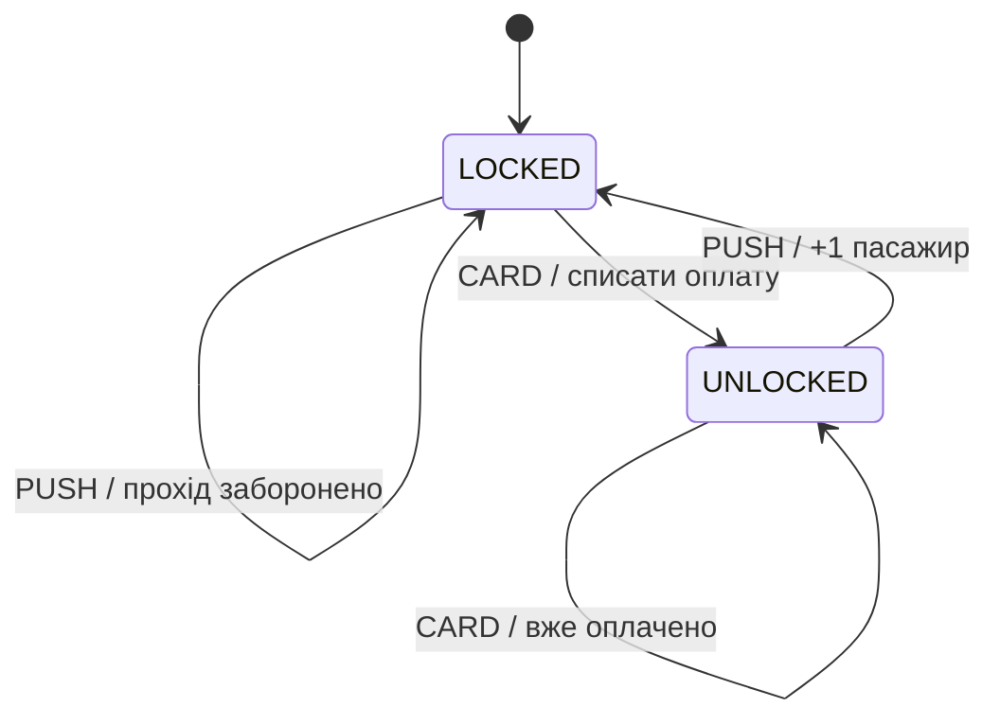
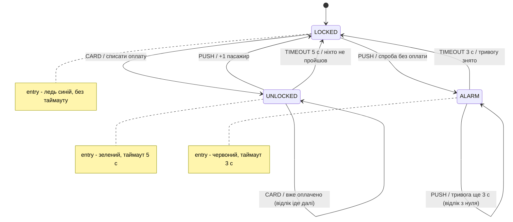

# Практика 6.4 - кінцеві автомати (FSM) на ESP-IDF

Код для живої демонстрації на уроці 6.4. Тема - кінцевий автомат: стани, події, переходи, таймаути. Приклад - турнікет у метро. Його всі бачили, і в нього рівно два «природні» стани: закрито і відкрито. Плата ESP32-S3-DevKitC-1, PlatformIO, `framework = espidf`, чистий C17: процедурно, без динамічної памʼяті.

Інструкції до практики в папці уроку немає, тому кроки я склала сама: від найпростішого `switch` до табличного автомата.

| Крок | Середовище | Файл | Що показує |
|---|---|---|---|
| 1 | `step1` | `src/step1_switch.c` | 2 стани, 2 події, вкладений `switch`, Producer → черга → Consumer |
| 2 | `step2` | `src/step2_timeout.c` | 3-й стан, таймаут як подія, дії входу (колір RGB), внутрішній перехід і відлік таймауту заново |
| 3 | `step3` | `src/step3_table.c` | та сама поведінка, що в кроці 2, але таблицею переходів |
| - | `lecture` | `src/lecture_alarm.c` | приклад із лекції (сигналізація + автомат кнопки), без змін |

```bash
pio run -e step1 -t upload -t monitor
```

Монітор відкривати на порту «UART» плати (USB-UART міст), не на «USB». Туди йде консоль ESP-IDF, і з неї задача `console` читає клавіші: `c` - прикласти картку, `p` - штовхнути турнікет. Будь-яка інша клавіша друкує підказку.

ESP-IDF у PlatformIO не підтримує `build_src_filter`, тому файл кроку вибирає `src/CMakeLists.txt`: середовище `stepN` збирає лише `src/stepN_*.c`. Для кроків до збірки додається `src/common_*.c` (драйвер RGB) і вмикаються `-Wextra -Wshadow -Wstrict-prototypes`. Приклад із лекції збирається без них, щоб не засмічувати вивід.

## Підключення

Нічого підключати не треба, потрібна лише плата. Кроки 2 і 3 показують стан кольором вбудованого RGB-світлодіода:

| Стан | Колір |
|---|---|
| LOCKED | ледь синій |
| UNLOCKED | зелений |
| ALARM | червоний |

Вбудований світлодіод - адресний WS2812, а не звичайний LED: колір передається послідовним протоколом (24 біти, імпульси ~0,4 / 0,8 мкс), тому `gpio_set_level()` його не вмикає. Імпульси формує периферія RMT через офіційний компонент Espressif `led_strip` (`src/idf_component.yml`, качається з ESP Component Registry при першій збірці, потрібен інтернет). Обгортка на два виклики - `include/rgb_led.h` + `src/common_rgb_led.c`, автомат знає лише `rgb_led_set(колір)`.

Пін залежить від ревізії плати: DevKitC-1 v1.0 - GPIO48, v1.1 - GPIO38. У коді стоїть 48 (`RGB_LED_PIN` у `src/common_rgb_led.c`). Не світиться - найперше перевірити ревізію.

## Архітектура (однакова в усіх кроках)

```
 клавіатура -> [ console_task ] --подія--> [ черга ] --> [ fsm_task ]
               Producer:                              Consumer:
               «c» -> EV_CARD                          стан, правила, дії
               «p» -> EV_PUSH                          (TIMEOUT генерує сам)
```

- Автомат не знає, звідки беруться події. Замінити консоль кнопкою, MQTT чи датчиком - це новий Producer, а автомат лишається як є.
- Стан - локальна змінна задачі `fsm_task`. У нього один власник, тому глобальні прапорці і гонки не потрібні.
- Черга статична (`xQueueCreateStatic`), heap під неї не потрібен.
- `fsm_task` важливіша за `console_task` (5 проти 4): подія обробляється одразу після надходження.

## Крок 1 - `switch`, два стани



| Стан \ Подія | CARD | PUSH |
|---|---|---|
| LOCKED | списати оплату → UNLOCKED | «прохід заборонено» → LOCKED |
| UNLOCKED | «вже оплачено» → UNLOCKED | +1 пасажир → LOCKED |

Що проговорити:
- Автомат = стани + події + правила, і більше нічого. Порівняти з версією на прапорцях `is_paid`, `was_pushed`: 2 прапорці дають 4 комбінації, з яких частина безглузда, і їх треба тримати узгодженими вручну. Стан завжди рівно один.
- Аналогія: кухар на кухні. Він не памʼятає всю історію замовлення, лише «зараз я смажу». Прийшла подія «пательня нагрілась» - дивиться, що робити саме в цьому стані.
- `switch` без `default`. Додай `TS_BROKEN` і забудь обробити: компілятор попередить. З `default` він би мовчав. Можна показати наживо.
- `handle_event()` повертає наступний стан, а присвоюється він в одному місці. Там же єдиний лог переходів `LOCKED --CARD--> UNLOCKED`. Помилку в логіці видно з логу, не відкриваючи дебагер.
- Події, які в стані «нічого не роблять», теж обробляються явно (UNLOCKED + CARD). Саме тут живе баг «двічі списали оплату», якщо писати на прапорцях.

## Крок 2 - таймаути, дії входу, третій стан



| Стан \ Подія | CARD | PUSH | TIMEOUT |
|---|---|---|---|
| LOCKED (без таймауту) | списати → UNLOCKED | «без оплати!» → ALARM | - |
| UNLOCKED (5 с) | «вже оплачено», відлік іде далі | +1 пасажир → LOCKED | «ніхто не пройшов» → LOCKED |
| ALARM (3 с) | «зачекайте», відлік іде далі | тривога ще 3 с, відлік з нуля | «тривогу знято» → LOCKED |

Що проговорити:
- Час - теж подія. Автомат не викликає `vTaskDelay` і не рахує «скільки минуло» в кожному `case`. Задача чекає в `xQueueReceive()` з таймаутом: нічого не прийшло вчасно - це подія `EV_TIMEOUT`, і обробляє її той самий `switch`. Між подіями задача спить (Blocked).
- Таймаут рахується в тіках FreeRTOS: при вході в стан запамʼятовуємо `xTaskGetTickCount()`, а перед кожним очікуванням рахуємо залишок `limit - (now - start)`. Беззнакове віднімання `now - start` - те саме, що `millis() - last` в Arduino, і так само переживає переповнення лічильника. Не лічильником `ms += 10`: інакше «секунда» залежала б від того, як часто задача прокидається. Нічого додаткового не потрібно: чекає сама черга.
- Від чого відлічувати таймаут - рішення автора автомата, і його треба приймати свідомо:
  - UNLOCKED + CARD - внутрішній перехід, відлік іде далі. Інакше пасажир, який щосекунди прикладає картку, тримав би турнікет відкритим вічно.
  - ALARM + PUSH - стан той самий, але відлік починається заново явною дією `deadline_restart()`: поки штовхають, тривога триває. Таймаут «від останньої активності».
  - Перехід в інший стан завжди починає відлік нового стану з нуля (`enter_state()`).
- Дії входу (`enter_state()`): колір і початок відліку задаються в одному місці, а не в кожному `case`, що веде в UNLOCKED. Вихід залежить лише від стану - це автомат Мура. Дії на переходах (списати оплату) - автомат Мілі. На практиці їх комбінують.
- `enter_state()` викликається і для початкового стану. Інакше після старту світлодіод не показує стан (або показує колір з минулого запуску: WS2812 памʼятає його до вимкнення живлення).
- `EV_TIMEOUT` у LOCKED обробляється явно, хоча прийти не може: так компілятор перевіряє повноту, а читач бачить, що випадок продуманий.

Сценарії для демонстрації:
1. `c`, зачекати 5 с - зелений сам змінюється на синій.
2. `c`, `c`, `c` з паузою в секунду - зелений все одно зникає через 5 с після першої картки.
3. `p` у LOCKED - червоний на 3 с. Потім `p` кожну секунду - червоний не зникає, поки штовхають.

## Крок 3 - таблиця переходів

Поведінка і діаграма точнісінько як у кроці 2. Змінюється лише форма запису:
- `TRANSITIONS[стан][подія]` - та сама таблиця, що вище, у вигляді `static const` масиву (лежить у флеші). Designated initializers (`[TS_LOCKED] = { [EV_CARD] = ... }`) роблять клітинки видимими за назвою.
- Порожня клітинка - нулі, тобто `.handled == false`, «подію ігноруємо». Безпечне значення за замовчуванням: забута клітинка лише залогується.
- `STATES[]` - все, що належить стану: імʼя, таймаут, колір. Дія входу просто застосовує ці дані.
- `dispatch()` - «двигун» на 15 рядків, однаковий для будь-якої таблиці. Він перевіряє межі масиву: некоректний стан не прочитає памʼять за таблицею.
- `static_assert` гарантує, що в таблицях імен і станів рівно `*_COUNT` рядків.

Коли що брати:
- `switch` - мало станів, у переходах різна логіка з умовами. Легко читати і дебажити.
- Таблиця - багато станів і подій, однотипні переходи. Видно всю поведінку одним поглядом, і її можна згенерувати з діаграми.

## Як практика покриває домашнє завдання (сейф)

Домашка: Consumer-автомат сейфа, пароль «коротке - коротке - довге» однією кнопкою, скидання на помилці і після 3 с бездіяльності. Код практики її не виконує, але всі механізми в ній є:

| Що потрібно в ДЗ | Де показано |
|---|---|
| стани і події як `enum`, вкладений `switch`, один лог переходів | крок 1 |
| Consumer, що читає події з черги і не знає про джерело | кроки 1-3, `fsm_task` |
| кілька станів по черзі, кожна правильна подія - крок уперед | кроки 2-3 (ланцюжок LOCKED → UNLOCKED → LOCKED) |
| повернення в початковий стан - явний перехід, а не `default` | кроки 2-3: UNLOCKED і ALARM повертаються в LOCKED; без `default` компілятор перевіряє, що кожна пара (стан, подія) продумана |
| таймаут бездіяльності як подія `EV_TIMEOUT` з `xQueueReceive` | крок 2, `wait_event()` |
| таймаут від останньої активності, а не від входу в стан | крок 2, ALARM + PUSH, `deadline_restart()` |
| реальний час у тіках замість `ms += 10` | крок 2, `xTaskGetTickCount()` + беззнакове віднімання |
| успіх через `ESP_LOGI`, тривога - `ESP_LOGW` | кроки 1-3 |
| Producer кнопки (SHORT / LONG) | `lecture_alarm.c` - приклад із лекції |

Варто проговорити окремо, бо це перший пункт «Де спотикаються» в `../Task.md`: `LONG` у прикладі з лекції приходить лише через 1 с утримання. Якщо таймаут сейфа перезапускається тільки від SHORT/LONG, автомат може скинутись, поки людина тримає кнопку. Автомат не бачить активності, про яку йому не повідомили. Висновок для студентів: якщо подія має продовжувати таймаут, Producer мусить про неї повідомити (наприклад, «кнопку натиснуто»). Готового рішення в практиці немає.

Що навмисно не включено:
- автомат сейфа і розпізнавання послідовності натискань - це домашка;
- автомат кнопки (антибрязкіт, коротке/довге) - він є в прикладі з лекції, а переписаний «правильно» став би частиною ДЗ;
- світлофор - класичний приклад, його залишаємо на лекцію.

## 🚀 На виріст

- Ієрархічні автомати (HSM): спільна реакція кількох станів (наприклад, «аварійне відключення живлення» з будь-якого стану) описується один раз у батьківському стані. Див. Miro Samek, «Practical UML Statecharts in C/C++», фреймворк QP.
- Юніт-тести логіки: `handle_event()` не торкається заліза (крім лічильників), тому її можна тестувати на ПК через `pio test -e native`.

## Джерела

- FreeRTOS: `xTaskGetTickCount` - https://www.freertos.org/Documentation/02-Kernel/04-API-references/03-Task-utilities/05-xTaskGetTickCount
- FreeRTOS: `xQueueReceive` з таймаутом - https://www.freertos.org/Documentation/02-Kernel/04-API-references/06-Queues/09-xQueueReceive
- ESP-IDF: компонент `led_strip` - https://components.espressif.com/components/espressif/led_strip
- ESP32-S3-DevKitC-1 User Guide (RGB LED: GPIO48 у v1.0, GPIO38 у v1.1) - https://docs.espressif.com/projects/esp-dev-kits/en/latest/esp32s3/esp32-s3-devkitc-1/user_guide.html
- ESP-IDF (ESP32-S3): UART driver, `uart_read_bytes` - https://docs.espressif.com/projects/esp-idf/en/stable/esp32s3/api-reference/peripherals/uart.html
- GCC: `-Wswitch` - https://gcc.gnu.org/onlinedocs/gcc/Warning-Options.html#index-Wswitch
- Miro Samek, «Practical UML Statecharts in C/C++», 2nd ed. - автомати Мура/Мілі, внутрішні переходи, HSM.
- Wikipedia: Finite-state machine, приклад з турнікетом - https://en.wikipedia.org/wiki/Finite-state_machine
