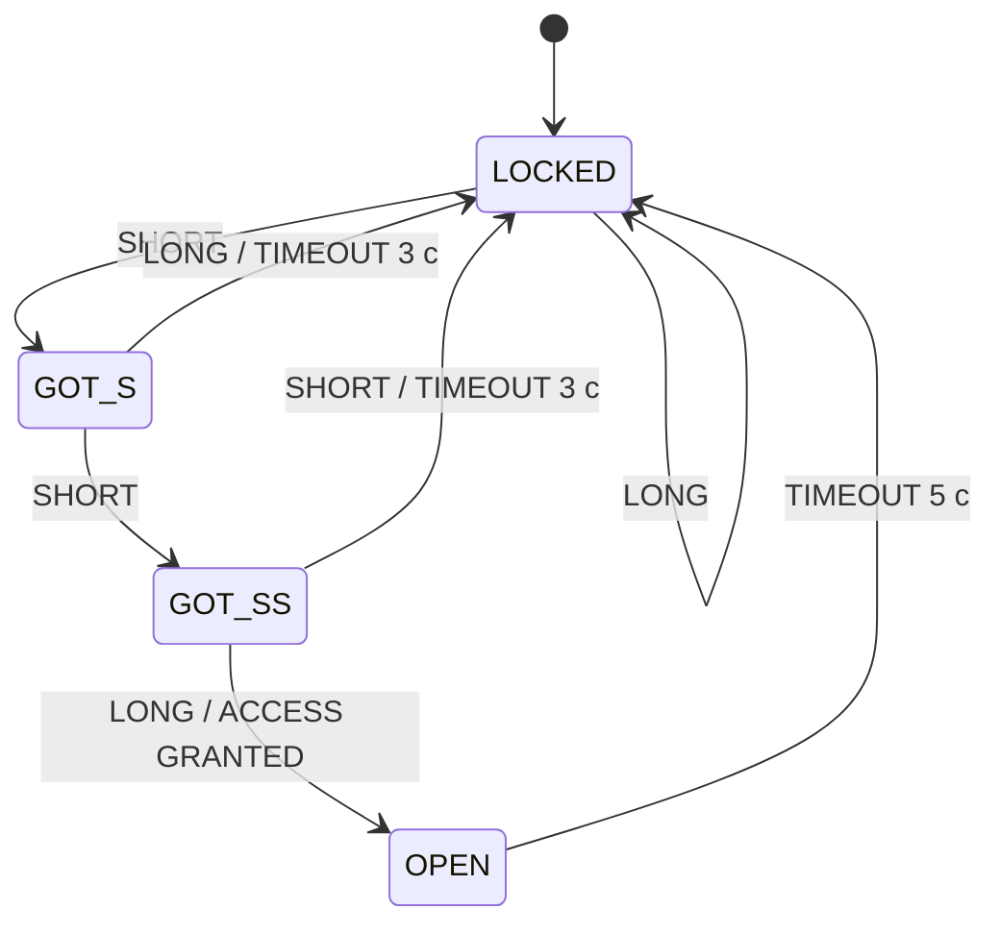

# Еталон 6.4 - кінцевий автомат: електронний сейф

Одна кнопка, пароль Коротке - Коротке - Довге. Плата ESP32-S3-DevKitC-1, PlatformIO, `framework = espidf`, чистий C17. Весь код - `src/main.c`.

Умова (`../Task.md`): написати кінцевий автомат сейфа (Consumer), який приймає події від автомата кнопки (Producer). Помилка або 3 с бездіяльності - миттєве скидання в початковий стан.

Еталон враховує типові помилки з перевірених робіт групи (таблиця наприкінці).

```bash
pio run -t upload -t monitor
```

## Схема

```
3V3
 │
 ├─ внутрішня підтяжка ~45 кОм (+ за бажанням зовнішні 10 кОм)
 │
GPIO4 ──── кнопка ──── GND

GPIO5 ──── 220 Ом ──── LED (анод → катод) ──── GND
```

| Компонент | Підключення | Чому так |
|---|---|---|
| Кнопка | GPIO4 - GND, підтяжка до 3V3 | без підтяжки вхід «плаває» і ловить наведення. Внутрішня підтяжка слабка (~45 кОм), на довгому проводі краще додати зовнішні 10 кОм |
| LED «відчинено» + 220 Ом | GPIO5 - резистор - LED - GND | (3,3 - 2,0) В / 220 Ом ≈ 6 мА: яскраво і з запасом до межі піна |

GPIO0 (BOOT) навмисно не використано: це strapping-пін, і затиснута під час скидання кнопка переводить плату в режим прошивки. Вбудований RGB-світлодіод плати - адресний WS2812, `gpio_set_level()` його не вмикає, тому світлодіод зовнішній.

## Архітектура

```
 GPIO4 -> [ button_task ] --PRESS/SHORT/LONG--> [ черга, 8 x uint8_t ] --> [ safe_task ] -> GPIO5
          Producer, пріоритет 4                                            Consumer, пріоритет 5
          опитування кожні 10 мс                                           стан, таймаути, LED
```

- Автомат сейфа не знає про GPIO і брязкіт, автомат кнопки не знає про пароль. Замінити кнопку на клавіатуру чи BLE - це новий Producer, автомат сейфа лишається як є.
- Стан сейфа - локальна змінна `safe_task`. Один власник, тому глобальних прапорців і гонок немає.
- Черга статична (`xQueueCreateStatic`) і створюється до задач. Consumer створюється першим.
- Правила переходів - чиста функція `safe_next(стан, подія)`. Без FreeRTOS і GPIO, її можна перевірити тестом на ПК.

## Автомат кнопки (Producer)

| Подія | Коли надсилається |
|---|---|
| `PRESS` | натискання прийнято після debounce |
| `SHORT` | відпустили раніше ніж через 1000 мс |
| `LONG` | утримання досягло 1000 мс, у цей самий момент (відпускання не чекаємо) |

- Debounce на обидва фронти: новий рівень приймається, лише коли протримався 30 мс (3 опитування). Кожен «стрибок» контакту перезапускає відлік, тому брязкіт відпускання не дає зайвого `SHORT`.
- Опитування через `vTaskDelayUntil`: період 10 мс не пливе від логів і навантаження.
- Час - різниця тіків з `>=`: `(TickType_t)(now - pressed_at) >= long_ticks`. Беззнакова арифметика переживає переповнення лічильника тіків, а зміна `POLL_PERIOD_MS` не ламає таймінги.

Навіщо `PRESS`: без нього сейф дізнається про натискання лише після відпускання. Користувач, який тримає кнопку для `LONG`, з погляду сейфа «нічого не робить», і таймаут 3 с може спрацювати посеред чесного утримання. `PRESS` перезапускає таймаут. А оскільки `LONG` приходить рівно через 1 с утримання, а таймаут 3 с, між подіями ніколи не буває паузи довшої за таймаут, поки людина вводить пароль. Це перевіряє `static_assert(LONG_PRESS_MS < INPUT_TIMEOUT_MS)`.

## Автомат сейфа (Consumer)



| Стан \ Подія | PRESS | SHORT | LONG | TIMEOUT |
|---|---|---|---|---|
| LOCKED (без таймауту) | LOCKED | GOT_S | LOCKED | - |
| GOT_S (3 с) | GOT_S, відлік заново | GOT_SS | LOCKED | LOCKED |
| GOT_SS (3 с) | GOT_SS, відлік заново | LOCKED | OPEN | LOCKED |
| OPEN (5 с, LED горить) | ігнор | ігнор | ігнор | LOCKED |

Що тут важливо:
- Таймаут - це параметр очікування черги: `xQueueReceive(q, &ev, залишок)`. Залишок рахується від входу в стан, а не від останнього пробудження, тому таймаут не «розтягується». У `LOCKED` задача чекає `portMAX_DELAY` і спить, а не прокидається 100 разів на секунду.
- Зі стану `OPEN` є вихід: сейф замикається сам через 5 с. Натискання у відчиненому сейфі цей час не продовжують, тому затиснута кнопка не тримає сейф відчиненим вічно.
- Натискання, яке почалося у відчиненому сейфі, а закінчилося вже після замикання, не стає першим символом нового пароля (прапорець `press_armed`).
- Світлодіод задає одна функція `apply_outputs(state)`, і горить він лише в `OPEN` (автомат Мура). Будь-яке скидання гарантовано його гасить. При старті пін спершу ставиться в 0, а потім у режим виходу, тому сейф не «блимає відчиненим» під час завантаження. Якщо задача не створилась, система лишається замкненою: при аварії виконавчий механізм має переходити в безпечний стан.
- Якщо черга переповнилась і подія загубилась, продюсер ставить `s_event_lost`, і автомат скидається. Інакше `S S L` з загубленим `S` перетворилося б на `S L`.
- `switch` у `safe_next` без `default`: додаси новий стан і забудеш обробити - компілятор попередить.
- Відкриття логується `ESP_LOGI` (це успіх, а не помилка), скидання - `ESP_LOGW`.

## Очікуваний лог

```
I (310) safe: locked, password: SHORT SHORT LONG
I (2150) safe: LOCKED --SHORT--> GOT_S
I (2600) safe: GOT_S --SHORT--> GOT_SS
I (3720) safe: GOT_SS --LONG--> OPEN: ACCESS GRANTED
I (8720) safe: OPEN --TIMEOUT--> LOCKED
I (10050) safe: LOCKED --SHORT--> GOT_S
W (13050) safe: GOT_S --TIMEOUT--> LOCKED: reset
I (14100) safe: LOCKED --SHORT--> GOT_S
W (15200) safe: GOT_S --LONG--> LOCKED: reset
```

Час у дужках - мс від старту (тік FreeRTOS 1 мс, `sdkconfig.defaults`). Переходи «у себе» (`PRESS`) не логуються, щоб лог читався як історія станів.

## Що перевірити на платі

| Сценарій | Очікування |
|---|---|
| S, S, L | `ACCESS GRANTED`, LED горить 5 с і гасне |
| S, S, утримувати 3+ с | `OPEN` через 1 с утримання, таймаут не спрацьовує |
| S, пауза 3 с | `TIMEOUT -> LOCKED` |
| S, L або S, S, S | миттєве скидання |
| у відчиненому сейфі тиснути й тримати кнопку | сейф однаково замикається через 5 с |
| натиснути у відчиненому, відпустити після замикання | нічого не відбувається, пароль вводиться з нуля |

## Типові помилки групи і як їх закрито

| Помилка в роботах | У еталоні |
|---|---|
| Таймаут «затупив» спрацьовує, поки користувач тримає кнопку для `LONG` | подія `PRESS` перезапускає таймаут, `LONG` надсилається в момент 1 с утримання |
| Час кнопки через `case 1000:` або `hold += 10` | різниця тіків з `>=`, `vTaskDelayUntil` |
| Брязкіт відпускання дає зайве `SHORT` | debounce на обидва фронти |
| Сейф відкривається назавжди, закрити - лише перезавантаженням | `OPEN` має таймаут 5 с |
| Затиснута кнопка тримає сейф відчиненим (кожна подія продовжує таймер) | у `OPEN` події ігноруються, таймер ставиться лише на вході |
| Натискання з відчиненого стану стають першим символом нового пароля | прапорець `press_armed` |
| LED перемикаються в різних переходах, при деяких скиданнях не гаснуть | одна функція `apply_outputs(state)` |
| Аварійна індикація вмикає LED «відчинено» | при помилці старту LED лишається вимкненим |
| Consumer прокидається кожні 10 мс у спокої | `portMAX_DELAY` у `LOCKED`, у решті станів - залишок таймауту |
| Загублена подія тихо ламає послідовність | `s_event_lost` -> скидання |
| Магічні числа, `#define` без типу, `ESP_LOGE` на успіх | `#define` з типом і одиницями в назві, `static_assert`, `ESP_LOGI` |
| Черга з купи, `enum` на 4 байти в черзі | `xQueueCreateStatic`, елемент - `uint8_t` |

## Що здавати

- Код (Producer і Consumer окремими задачами, зв'язок через чергу).
- Діаграму або таблицю переходів автомата сейфа.
- Лог з плати за сценаріями з таблиці «Що перевірити на платі».

## 🚀 На виріст (поза програмою модуля)

- Кнопка на перериванні замість опитування: ISR на першому фронті вимикає своє переривання (`gpio_intr_disable`) і будить задачу, задача вмикає його назад після стабільного «відпущено». У спокої CPU взагалі не прокидається.
- Табличний автомат: `static const` масив `[SAFE_COUNT][EV_COUNT]` з наступним станом замість `switch` (див. `../6_4_Practice/src/step3_table.c`).
- Тест `safe_next()` на ПК (`pio test -e native`): перебрати всі пари стан-подія.
- Захист від підбору: після N невдалих спроб блокування на хвилину, лічильник - у NVS, щоб не скидався перезавантаженням.
