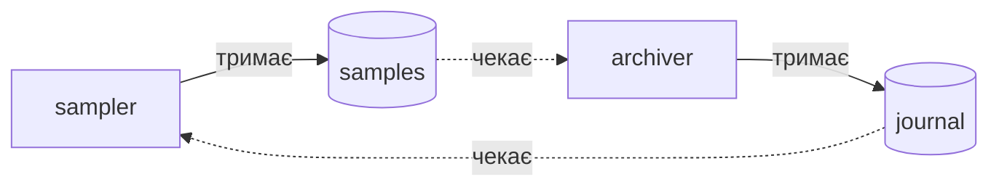

# Практика 6.5 - Race Condition, Mutex, Deadlock, семафори, task notification

Код для живої демонстрації на уроці 6.5. Кроки йдуть за розділом «Що показуємо покроково» з методички (`../EMB_Модуль_6_5_Mutex_Semaphore_Deadlock.docx`). Плата ESP32-S3-DevKitC-1, PlatformIO, `framework = espidf`, чистий C17: процедурно, без динамічної памʼяті (усі mutex і семафори - `...CreateStatic`).

UART і SPI ще не вивчали, тому в прикладах їх немає. Спільні ресурси - буфери і лічильники в памʼяті. Приклад deadlock «SPI + UART» з методички замінено на два буфери (`samples` і `journal`), пул SPI-транзакцій - на пул із двох буферів. Вивід - звичайний `ESP_LOGx` у монітор.

| Крок | Середовище | Файл | Що показує | Час |
|---|---|---|---|---|
| 1 | `step1` | `src/step1_race.c` | Race Condition: лічильник на двох ядрах губить інкременти | 7 хв |
| 2 | `step2` | `src/step2_mutex.c` | той самий лічильник під mutex; коротка і довга критична секція | 8 хв |
| 3 | `step3` | `src/step3_deadlock.c` | deadlock на двох mutex, потім таймаут з відкатом і однаковий порядок | 8 хв |
| 4 | `step4` | `src/step4_isr_semaphore.c` | бінарний семафор ISR → задача на кнопці BOOT, `portYIELD_FROM_ISR` | 8 хв |
| 5 | `step5` | `src/step5_counting.c` | лічильний семафор: пул з 2 буферів на 4 задачі | 7 хв |
| 6 | `step6` | `src/step6_inversion.c` | Priority Inversion: бінарний семафор проти mutex з успадкуванням | 5 хв |
| 7 | `step7` | `src/step7_task_notify.c` | крок 4 через task notification замість бінарного семафора | 5 хв |

```bash
pio run -e step1 -t upload -t monitor
```

`pio run` без `-e` збирає і прошиває лише `step1` (`default_envs`).

ESP-IDF у PlatformIO не підтримує `build_src_filter`, тому файл кроку вибирає `src/CMakeLists.txt`: середовище `stepN` збирає лише `src/stepN_*.c`. Для всіх кроків увімкнено `-Wextra -Wshadow -Wstrict-prototypes`. Спільне (ядра, стеки, `check_task_created()`, `busy_work_ms()`) - у `include/practice.h`.

Перемикачі на початку файлів (змінити, прошити знову):

| Файл | Перемикач | Значення |
|---|---|---|
| `step1_race.c` | `SAME_CORE` | 0 - задачі на різних ядрах, 1 - обидві на ядрі 0 |
| `step3_deadlock.c` | `DEADLOCK_MODE` | 0 - deadlock, 1 - таймаут з відкатом, 2 - однаковий порядок |
| `step4_isr_semaphore.c`, `step7_task_notify.c` | `USE_PORT_YIELD` | 1 - з `portYIELD_FROM_ISR`, 0 - без |

## Підключення

Нічого підключати не треба, потрібна лише плата. Кроки 4 і 7 використовують кнопку BOOT (GPIO0) на самій платі.

## Крок 1 - Race Condition

Дві задачі, `worker0` на ядрі 0 і `worker1` на ядрі 1, по мільйону разів роблять `s_counter++`. Очікуємо 2 000 000, отримуємо менше, і щоразу інше число.

```
W (1325) race: Раунд 1: 1203117 з 2000000, загублено 796883 (39.8%), 64 мс
```

(число в лозі - ілюстрація, на платі буде своє)

Що проговорити:
- `counter++` - це три інструкції: прочитати з памʼяті, додати 1 у регістрі, записати назад (Read-Modify-Write). Два ядра одночасно прочитали 5, обидва записали 6. Аналогія з методички: двоє в різних банкоматах одночасно бачать на рахунку $100 і обидва знімають по $80.
- На ESP32-S3 це фізично одночасно: два ядра працюють паралельно. `SAME_CORE 1` показує одноядерний випадок (як STM32F411): гонка є, лише коли планувальник витіснить задачу точно між читанням і записом. Втрат значно менше, часто нуль. Тому такий баг проходить тести і вилазить у полі.
- `volatile` не рятує. Він забороняє тримати змінну в регістрі, але не робить три інструкції однією. Без `volatile` компілятор злив би цикл в одне `+= 1000000`, і гонки не було б видно.
- Старт і фініш раунду - лічильні семафори (`s_start`, `s_done`). Тут вони просто «стартовий пістолет» і «фінішна лінія», детально - у кроці 5.

## Крок 2 - Mutex

Той самий лічильник, раунди по черзі в трьох режимах:

| Режим | Результат | Час | Чому |
|---|---|---|---|
| без захисту | неправильний | найшвидший | як у кроці 1 |
| mutex на `++` | правильний | найповільніший | 200 000 пар Take/Give - кожна є викликом ядра FreeRTOS |
| mutex на весь цикл | правильний | швидкий | але задачі працюють по черзі, паралельності немає, друга задача весь цикл стоїть у Blocked |

Що проговорити:
- Mutex - ключ від кімнати з ресурсом. Ключ один, і повернути його може лише той, хто взяв (власник, `pxMutexHolder`). Усередині FreeRTOS mutex - черга довжиною 1 плюс поле власника.
- Кожен доступ до спільних даних - під тим самим mutex. Один незахищений доступ ламає все.
- `xSemaphoreTake` з таймаутом і перевірка результату. Не взяли - знаємо про це (`таймаутів: N` у лозі), а не висимо.
- Критична секція - якомога коротша. Режим «mutex на цикл» правильний, але поки ключ у однієї задачі, всі інші, кому потрібен ресурс, стоять.
- Mutex - для ресурсів, з якими працюють довше за одну інструкцію: буфер, структура, драйвер. Для одного лічильника він задорогий, див. «На виріст».

## Крок 3 - Deadlock

Два ресурси в памʼяті, кожен під своїм mutex: `samples` (буфер вимірювань) і `journal` (журнал подій). `sampler` (ядро 0) бере `samples → journal`, `archiver` (ядро 1) - `journal → samples`. Монітор в `app_main` раз на секунду друкує прогрес і власника кожного mutex (`xSemaphoreGetMutexHolder`).



Порядок показу:
1. `DEADLOCK_MODE 0` - протилежний порядок і `portMAX_DELAY`. Після першої ж спроби лог задач замовкає. Монітор показує `samples тримає sampler, journal тримає archiver` і `DEADLOCK`. Підкреслити: без монітора не було б видно взагалі нічого, система просто «тиха».
2. `DEADLOCK_MODE 1` - той самий порядок, але таймаут і відкат (`take_both()` віддає перший mutex, якщо другий не взявся). Система жива, але в лозі зʼявляються `таймаут, ресурси віддано`. Таймаут не прибрав причину, він зробив її видимою.
3. `DEADLOCK_MODE 2` - однаковий порядок `samples → journal` в обох задачах. Відмов нуль, таймаут лишається як страховка.

Що проговорити:
- Чотири умови Коффмана: взаємне виключення, утримання й очікування, немає примусового звільнення, циклічне очікування. Достатньо зламати одну. Режим 1 ламає «утримання й очікування», режим 2 - «циклічне очікування».
- `vTaskDelay` всередині критичних секцій тут навмисно: розширює вікно, щоб deadlock стався за секунду. У реальному коді секції короткі, тому deadlock буває раз на тиждень.
- Лог - після відкату, коли жоден mutex не тримаємо: вивід у консоль повільний.
- Чому `portMAX_DELAY` при очікуванні ресурсу - антипатерн: при помилці синхронізації система зависає мовчки, без діагностики. Чекати так команду, коли задача просто спить без роботи (як `s_start` у кроках 1-2), - нормально.

## Крок 4 - бінарний семафор ISR → задача

Натискаєш BOOT - ISR дає семафор, задача `button` прокидається і друкує номер натискання і затримку від переривання до задачі в мікросекундах.

Що робить ISR, і більше нічого:
1. запамʼятовує час (`esp_timer_get_time()`);
2. вимикає своє переривання (`gpio_intr_disable`) - антибрязкіт: решта фронтів брязкоту просто не приходить;
3. `xSemaphoreGiveFromISR`;
4. `portYIELD_FROM_ISR`.

Задача після обробки чекає, поки кнопка буде стабільно відпущена 30 мс, і лише тоді вмикає переривання знову. Якщо після ввімкнення спрацював «залишковий» фронт, а кнопка вже відпущена, задача його ігнорує (Trust No Pin).

Що проговорити:
- Семафор - дзвінок у двері: натискає один (ISR), відчиняє інший (задача). Mutex - ключ з одним власником. Тому mutex з ISR не беруть, а семафор з ISR дають, і лише `...FromISR`: звичайний `xSemaphoreGive` в ISR - крах.
- `USE_PORT_YIELD 0` - прибрати yield і понатискати. Тік FreeRTOS в ESP-IDF за замовчуванням 10 мс (`CONFIG_FREERTOS_HZ=100`, не 1000, як у прикладі з методички), тому затримка стрибає від одиниць мкс до ~10 мс. З yield - стабільно мікросекунди.
- Порядок в `app_main`: семафор → задача → переривання. Інакше натискання під час старту - `xSemaphoreGiveFromISR(NULL)` і падіння.
- Задача на ядрі 0, де встановлено сервіс переривань GPIO. Тоді `portYIELD_FROM_ISR` перемикає саме те ядро, на якому вона чекає.
- Очікування з таймаутом 5 с: задача гарантовано прокидається і може, наприклад, годувати watchdog.

## Крок 5 - лічильний семафор

4 задачі (по дві на кожному ядрі), 2 статичні буфери. Кожна задача бере семафор пулу (чекає не довше 400 мс), вибирає конкретний вільний буфер, 300 мс «обробляє пакет» і повертає все назад. У лозі видно, що одночасно працюють не більше двох, а частина задач не дочікується і пропускає раунд.

Що проговорити:
- Лічильний семафор - табло вільних місць на парковці. `xSemaphoreCreateCounting(2, 2)` - пул на 2 місця, всі вільні. `(N, 0)` - лічильник подій (так у кроках 1-2 `app_main` чекав завершення задач).
- Семафор каже, скільки місць вільно, але не яке. Вибір буфера - читання і запис таблиці `s_slot_busy`, тобто знову Read-Modify-Write. Тому таблицю захищає окремий mutex. Лічильний семафор не захищає дані, він лише обмежує кількість учасників.
- З буфером, який задача вже отримала, mutex не потрібен: у нього зараз один власник.
- Звільнення у зворотному порядку: спершу буфер у таблиці, потім місце в семафорі. Не вдалось оновити таблицю - семафор не віддаємо, інакше лічильник розійдеться з таблицею.

## Крок 6 - Priority Inversion

Три задачі на одному ядрі (ядро 1, як на одноядерному МК): L (пріоритет 2) працює з ресурсом 50 мс, H (4) теж хоче ресурс, M (3) ресурс не потрібен, вона 300 мс просто рахує. Раунди чергують «замок» на ресурсі:

```
W (...) inversion: бінарний семафор: H чекала 330 мс, пріоритет L під час роботи: 2
I (...) inversion: mutex           : H чекала  30 мс, пріоритет L під час роботи: 4
```

(очікувані значення: без успадкування ≈ 30 + 300 мс, з успадкуванням ≈ 30 мс, бо 20 мс з 50 L встигає до появи H)

Що проговорити:
- Інверсія: H чекає M, якій ресурс навіть не потрібен. Фактично найважливіша задача працює з пріоритетом нижче середньої.
- Бінарний семафор не має власника: FreeRTOS не знає, кого «підганяти». Mutex знає (`pxMutexHolder`) і тимчасово піднімає L до пріоритету H. Це видно в лозі: `пріоритет L під час роботи: 4`.
- Успадкування не прибирає інверсію повністю, а обмежує її тривалістю критичної секції L. Ще одна причина тримати секції короткими.
- Mars Pathfinder, 1997: watchdog перезавантажував марсохід, бо H не встигала. Виправили з Землі, увімкнувши успадкування пріоритету.
- В ESP-IDF успадкування в mutex завжди ввімкнене. В CMSIS-OS v2 (STM32CubeMX) - лише з атрибутом `osMutexPrioInherit`, і CubeMX сам його не ставить. Компілюється без помилок, ламається під навантаженням.
- Висновок для вибору примітиву: ресурс з власником - mutex; сигнал (ISR → задача, «готово») - бінарний семафор; N однакових ресурсів - лічильний семафор (+ mutex, якщо є спільні дані).

## Крок 7 - task notification

Той самий код, що в кроці 4 (кнопка BOOT, антибрязкіт, вимір затримки), але без семафора. Заміна один до одного:

| Крок 4 (семафор) | Крок 7 (нотифікація) |
|---|---|
| `SemaphoreHandle_t` + `StaticSemaphore_t` | `TaskHandle_t` задачі-отримувача |
| `xSemaphoreGiveFromISR(sem, &woken)` | `vTaskNotifyGiveFromISR(task, &woken)` |
| `xSemaphoreTake(sem, timeout)` | `ulTaskNotifyTake(pdTRUE, timeout)` |

```
I (...) notify: Натискай BOOT. USE_PORT_YIELD = 1. StaticSemaphore_t з кроку 4: N байт, тут: 0
I (...) notify: натискання #1, нотифікацій: 1, ISR -> задача: ... мкс
```

Що проговорити:
- У кожної задачі FreeRTOS вже є поле нотифікації в TCB: 32-бітне значення і стан «чекає / отримала». ISR пише прямо туди, окремий обʼєкт не потрібен. Тому нотифікація легша і швидша за семафор (за документацією FreeRTOS до 45% швидше). Розмір зекономленого обʼєкта друкується при старті.
- Семафор - дзвінок у двері (відчинить той, хто почує), нотифікація - дзвінок на особистий мобільний конкретної людини.
- `ulTaskNotifyTake` повертає значення лічильника до очищення: `pdTRUE` - обнулити (як бінарний семафор, але видно, скільки подій злиплось в одну), `pdFALSE` - відняти 1 (як лічильний). Тут переривання вимикається на першому фронті, тому в лозі завжди `нотифікацій: 1`.
- Порядок в `app_main`: задача (handle) → переривання. Інакше `vTaskNotifyGiveFromISR(NULL)` і падіння.
- Обмеження: отримувач рівно один, і його handle треба знати заздалегідь; чекати може лише сама задача-власник. Кілька отримувачів, пул чи лічильник для кількох задач - семафор.

## Семафор, mutex чи черга

Підсумок уроку. Зручно пояснювати як драбину від черги до mutex: у FreeRTOS це буквально одна структура. `xSemaphoreCreateBinary()` - макрос над `xQueueGenericCreate(1, 0, ...)`, тобто черга довжиною 1 з елементами розміром 0 байт. Кожна сходинка нижче прибирає з черги щось одне.

| Примітив | Що несе | Аналогія |
|---|---|---|
| черга | дані: що саме сталося | конвеєр з посилками |
| лічильний семафор | лише кількість: скільки разів сталося | табло вільних місць на парковці |
| бінарний семафор | лише факт: чи сталося (0 або 1) | дзвінок у двері |
| mutex | факт і власника | ключ від кімнати |
| task notification | факт або кількість, лише одній відомій задачі, без окремого обʼєкта | дзвінок на особистий мобільний |

Одне речення для слайда: черга - що сталося, семафор - скільки разів сталося, mutex - хто зараз працює з ресурсом. Task notification - той самий семафор, вбудований у конкретну задачу (крок 7).

### Семафор проти черги

Черга передає дані, семафор передає тільки «сталося». Питання для вибору: чи треба задачі знати, що саме прийшло?
- «кнопка натиснута, прокинься» - семафор;
- «натиснута кнопка 3, довге натискання, о 12:05» - черга;
- «прийшов байт, ось він» - черга.

Лічильний семафор - це черга, з якої викинули посилки і залишили лише лічильник. Тому він легший: не копіює дані і не займає памʼять під елементи.

### Бінарний проти лічильного

У двері подзвонили тричі, поки ти був у душі. Вийшовши, ти знаєш одне: хтось дзвонив. Так працює бінарний семафор: два `Give` до одного `Take` дають одну подію, решта губиться. Лічильний памʼятає «три рази», черга - ще й «хто саме». Якщо втрачати події не можна, бінарний семафор не годиться.

### Семафор проти mutex

Головна різниця - власник:
- семафор - дзвінок: натискає один (ISR), відчиняє інший (задача). Власника немає, і це нормально;
- mutex - ключ: хто взяв, той і повертає. FreeRTOS памʼятає власника (`pxMutexHolder`).

З власника випливають три речі, яких семафор не має:
1. Успадкування пріоритету: ядро знає, кого «підганяти» (крок 6).
2. Mutex не можна брати чи віддавати з ISR: у переривання немає «власника», і чекати воно не може.
3. Віддати mutex може лише задача, що його взяла. Віддати з іншої задачі - спрацює `configASSERT`, в ESP-IDF це перезавантаження.

Семафор - для сигналізації («подія сталася», «є N вільних ресурсів»). Mutex - для захисту ресурсу («зараз з буфером працюю я»).

### Коли правильно брати семафор

Семафор потрібен, коли треба передати факт або кількість, а не дані, і коли той, хто дає, і той, хто бере, - різні учасники.

1. Переривання будить задачу (бінарний). ISR робить мінімум, обробка - у задачі (deferred interrupt processing): кнопка натиснута, датчик виставив DRDY («дані готові»), таймер «тікнув». Умова: задача сама знає, що робити, і їй не важливо, скільки разів подія сталася, поки вона була зайнята. Крок 4.
2. Підрахунок подій без даних (лічильний, `(N, 0)`). Втрачати не можна, але зміст однаковий: імпульси датчика витрати чи енкодера, які задача обробляє пачкою; «прийшов ще один пакет» (самі пакети - у кільцевому буфері). Коли лічильник дійшов до `max`, наступний `Give` повертає `pdFAIL` і подія губиться, тому результат треба перевіряти.
3. Пул однакових ресурсів (лічильний, `(N, N)`). N буферів чи слотів, одночасно - не більше N задач. Якщо є спільні дані («хто що зайняв»), їх додатково захищає mutex. Крок 5.
4. Синхронізація старту і фінішу (лічильний, `(N, 0)`). `app_main` чекає, поки N задач ініціалізуються, або координатор чекає, поки N задач закінчать раунд. Кроки 1-2.

### Коли семафор не потрібен

| Потрібно | Правильний вибір | Чому не семафор |
|---|---|---|
| захистити буфер чи структуру | mutex | у семафора немає власника, а отже й успадкування пріоритету |
| передати значення | черга | інакше дані лежатимуть у глобальній змінній, і буде гонка |
| сигнал одній відомій задачі | task notification (крок 7) | за документацією FreeRTOS до 45% швидше і без окремого обʼєкта в RAM |
| чекати кілька різних умов («Wi-Fi є» і «датчик готовий») | event group | один семафор - одна умова |

На ESP-IDF у новому коді випадок 1 частіше роблять через task notification. Семафор лишається, коли отримувачів кілька, коли задача ще не відома на момент створення або коли це пул чи лічильник.

### Типові помилки

- Mutex як сигнал: «ISR дає mutex». Не працює.
- Бінарний семафор як замок. Працює, але без успадкування пріоритету, тобто з priority inversion (Mars Pathfinder, крок 6).
- Семафор там, де потрібні дані: «семафор сказав, що значення є, а саме значення - у глобальній змінній». Гонка на цій змінній. Потрібна черга.
- Лічильний семафор як захист даних. Він обмежує кількість учасників, але не захищає дані, з якими вони працюють (крок 5).

### Правила, якщо вже семафор

1. Створити до того, як його може використати ISR чи задача (до `gpio_isr_handler_add`).
2. В ISR - лише `xSemaphoreGiveFromISR` і `portYIELD_FROM_ISR`.
3. `Take` з таймаутом, якщо мовчання джерела - аварія. `portMAX_DELAY` - лише там, де задача справді не має чого робити без події.
4. Бінарний семафор створюється порожнім. Якщо він служить замком (краще взяти mutex), його треба один раз «відкрити» через `Give`.
5. У пулі кожен `Take` має рівно один парний `Give` на всіх шляхах виходу, разом із помилками. Інакше пул «протікає» і місця зникають назавжди.

## Як практика стосується домашнього завдання

У методичці 6.5 написано «домашнього завдання немає», але в `../Task.md` є завдання з `Домашки.txt` (лічильник деталей з ISR, спільний буфер звіту з двох ядер, аварійна зупинка). Код практики його не виконує, але всі механізми в ньому є:

| Що потрібно в ДЗ | Де показано |
|---|---|
| спільні дані між ядрами під mutex, Take з таймаутом | кроки 2, 3 |
| чому `volatile` не робить `++` неподільним | крок 1 |
| ISR → задача через бінарний семафор, `portYIELD_FROM_ISR` | крок 4 |
| антибрязкіт через вимкнення переривання | крок 4 |
| порядок ініціалізації: семафор до `gpio_isr_handler_add` | крок 4 |
| задача з найвищим пріоритетом, що спить до сигналу | кроки 4, 6 |
| запис і лог поза критичною секцією | кроки 3, 5 |

Що навмисно не включено:
- лічильник деталей, інкрементований з ISR (у кроці 4 рахує задача, а не ISR);
- спільний рядок-звіт, який дві задачі по черзі доповнюють, і розрахунок деталей/хв;
- аварійна зупинка: прапорець «зупинено», `SYSTEM HALTED!`, блокування інших задач;
- АЦП і світлодіод тривоги.

## 🚀 На виріст

- Для одного лічильника промисловий вибір - не mutex, а атомарна операція: `atomic_fetch_add(&counter, 1)` з `<stdatomic.h>` (на ESP32-S3 - інструкція `S32C1I`, без виклику ядра) або критична секція зі спінлоком `portENTER_CRITICAL(&mux)` / `portEXIT_CRITICAL(&mux)`. Спінлок вимикає переривання на ядрі, тому всередині - лише кілька інструкцій. У кроці 2 можна додати четвертий режим і порівняти час.
- Recursive mutex (`xSemaphoreCreateRecursiveMutex`, `xSemaphoreTakeRecursive`) дозволяє одній задачі взяти той самий mutex вкладено. Потреба в ньому зазвичай означає, що публічна функція з mutex викликає іншу публічну функцію з тим самим mutex. Краще винести внутрішню незахищену функцію.
- Наступна тема - event groups: очікування кількох різних умов однією задачею. Також нотифікація вміє більше, ніж «Give/Take»: `xTaskNotify` з `eSetBits` передає бітові прапорці, з `eSetValueWithOverwrite` - значення (як черга довжиною 1).

## Джерела

- FreeRTOS: Mutexes, Priority Inheritance - https://www.freertos.org/Documentation/02-Kernel/02-Kernel-features/02-Queues-mutexes-and-semaphores/04-Mutexes
- FreeRTOS: Binary semaphores - https://www.freertos.org/Documentation/02-Kernel/02-Kernel-features/02-Queues-mutexes-and-semaphores/02-Binary-semaphores
- FreeRTOS: Counting semaphores - https://www.freertos.org/Documentation/02-Kernel/02-Kernel-features/02-Queues-mutexes-and-semaphores/03-Counting-semaphores
- FreeRTOS: Task notifications (швидкість і RAM порівняно із семафором) - https://www.freertos.org/Documentation/02-Kernel/02-Kernel-features/03-Direct-to-task-notifications/01-Task-notifications
- FreeRTOS: Event groups - https://www.freertos.org/Documentation/02-Kernel/02-Kernel-features/06-Event-groups
- ESP-IDF (ESP32-S3): FreeRTOS (IDF), SMP і закріплення задач за ядрами - https://docs.espressif.com/projects/esp-idf/en/stable/esp32s3/api-reference/system/freertos_idf.html
- ESP-IDF (ESP32-S3): GPIO, `gpio_isr_handler_add`, `gpio_intr_disable` - https://docs.espressif.com/projects/esp-idf/en/stable/esp32s3/api-reference/peripherals/gpio.html
- ESP32-S3-DevKitC-1 User Guide (кнопка BOOT на GPIO0) - https://docs.espressif.com/projects/esp-dev-kits/en/latest/esp32s3/esp32-s3-devkitc-1/user_guide.html
- Coffman, Elphick, Shoshani, «System Deadlocks», ACM Computing Surveys, 1971 - чотири умови deadlock.
- Glenn Reeves, «What really happened on Mars?» (Mars Pathfinder, 1997) - https://www.cs.cornell.edu/courses/cs614/1999sp/papers/pathfinder.html
